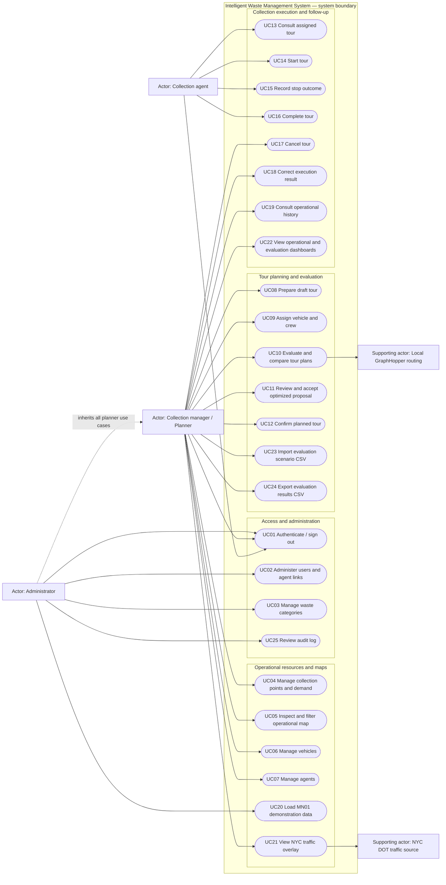

# Use-case diagram

## 1. Purpose and actors

The diagram gives a grouped overview of the 39 atomic stories in `docs/05-scrum.md`. Rounded
nodes inside the boundary are system use cases; rectangles outside it are human or supporting
system actors. Mermaid has no native use-case notation, so a flowchart is used for the overview.

- **Administrator:** manages accounts, waste categories, demonstration data, and the audit log.
  The dashed inheritance arrow means that `ADMIN` also has every planner capability (D-026).
- **Collection manager / planner:** prepares and evaluates tours, manages operational resources,
  and reviews operational/evaluation information.
- **Collection agent:** uses a linked active `AGENT` account to consult and execute only assigned
  tours.
- **Local GraphHopper routing:** a supporting system actor supplying directed road costs and
  road-following geometry from a versioned local graph.
- **NYC DOT traffic source:** a supporting system actor supplying timestamped traffic-link data
  for display only.

The course reviewer is a stakeholder, not a separate application role: the reviewer uses the
seeded administrator/planner/agent demonstrations.

## 2. Diagram

## 3. Short use-case descriptions

| ID | Use case and primary actor | Short description | Traceability |
|---|---|---|---|
| UC01 | **Authenticate / sign out** — all users | Validate an active account, establish the user's role-based session, and invalidate it on sign-out. Reject invalid or deactivated credentials. | US-01, US-02, US-03; FR-01, FR-02 |
| UC02 | **Administer users and agent links** — Administrator | Create accounts, assign one role, activate/deactivate access, and maintain the optional one-to-one link between an operational agent and an `AGENT` account. | US-04, US-05, US-16; FR-09, FR-27 |
| UC03 | **Manage waste categories** — Administrator | Create, edit, and deactivate categories without deleting historical demand or result references. | US-06, US-07; FR-03 |
| UC04 | **Manage collection points and demand** — Planner | Create, edit, and deactivate points; set coordinates through a form/map; and maintain one or more kilogram demand entries per point. | US-08, US-10, US-11, US-12; FR-04, FR-05, FR-06, FR-23 |
| UC05 | **Inspect and filter operational map** — Planner | Display depot/points, source and demand details, filters, layers, and synchronized list/map selection. | US-09; FR-22 |
| UC06 | **Manage vehicles** — Planner | Register and edit vehicles, validate positive kilogram capacity, and change availability without erasing assignments. | US-13, US-14; FR-07, FR-08 |
| UC07 | **Manage agents** — Planner | Register and edit operational agents and change their availability for driver/collector assignment. | US-15, US-17; FR-09 |
| UC08 | **Prepare draft tour** — Planner | Create a `DRAFT`, choose its depot/date, select eligible stops, and arrange the explicit input order used by the baseline. | US-18, US-19; FR-11, FR-15, FR-23 |
| UC09 | **Assign vehicle and crew** — Planner | Assign one vehicle, one driver, and zero to two distinct collectors; report mixed-category demand against vehicle capacity. | US-20; FR-06, FR-08, FR-10, FR-11 |
| UC10 | **Evaluate and compare tour plans** — Planner | Run input order, nearest neighbor, and NN + directed-cost 2-opt on one frozen scenario; retain orders, road geometry, indicators, feasibility, and snapshot IDs; explain failures. | US-21, US-22, US-23; FR-15, FR-16, FR-18, FR-19, FR-20, FR-21, FR-24 |
| UC11 | **Review and accept optimized proposal** — Planner | Inspect the proposal, explicitly apply it to the editable draft or reject it, and never allow automatic operational acceptance. | US-24; FR-16, FR-17, FR-21 |
| UC12 | **Confirm planned tour** — Planner | Revalidate the complete draft and move it to `PLANNED`, after which ordinary structural edits are locked. | US-25; FR-08, FR-10, FR-11, FR-17 |
| UC13 | **Consult assigned tour** — Collection agent | Read only the agent's assigned tour, ordered stops, demands, road route, and execution states in map and accessible list forms. | US-26; FR-02, FR-12, FR-24 |
| UC14 | **Start tour** — Assigned collection agent | Start a valid `PLANNED` tour after rechecking its resources, moving it to `IN_PROGRESS`. | US-27; FR-10, FR-11, FR-13 |
| UC15 | **Record stop outcome** — Assigned crew member | Move a pending stop to `COLLECTED` with category quantities or `NOT_COLLECTED` with an incident/reason, retaining actor and UTC time. | US-28; FR-02, FR-13, FR-24 |
| UC16 | **Complete tour** — Assigned crew member | Complete an active tour only when every stop has a terminal outcome and retain its full execution record. | US-29; FR-11, FR-13, FR-14 |
| UC17 | **Cancel tour** — Planner | Cancel a draft, planned, or in-progress tour with a reason while retaining all recorded work. | US-30; FR-11, FR-14 |
| UC18 | **Correct execution result** — Planner | Correct an outcome, quantity, or incident through a reasoned, audited privileged operation. | US-31; FR-13, FR-14, FR-30 |
| UC19 | **Consult operational history** — Planner | Filter completed/cancelled tours and inspect their resources, stops, outcomes, quantities, incidents, and timestamps. | US-32; FR-14 |
| UC20 | **Load MN01 demonstration data** — Administrator | Reproducibly load the included real basket/depot extracts and clearly labelled synthetic demo operations. | US-33; FR-26 |
| UC21 | **View NYC traffic overlay** — Planner | Show official traffic links, observation timestamps, coverage limits, and attribution without changing optimization costs. | US-34; FR-25 |
| UC22 | **View operational and evaluation dashboards** — Planner | Summarize resources/tour progress and explore retained three-method comparisons with their reproducibility metadata. | US-35, US-36; FR-20, FR-21, FR-28 |
| UC23 | **Import evaluation scenario CSV** — Planner | Validate a documented scenario-point CSV atomically and preserve its input order and provenance for identical three-method evaluation. | US-37; FR-15, FR-29 |
| UC24 | **Export evaluation results CSV** — Planner | Export all retained scenario/method outcomes and the values needed to recalculate reported changes. | US-38; FR-20, FR-21, FR-29 |
| UC25 | **Review audit log** — Administrator | Search sign-in and data-change events by time, actor, action, entity, and outcome without exposing credentials. | US-39; FR-01, FR-30 |

## 4. Cross-cutting rules

- Every protected use case includes server-side authentication and authorization; hiding a UI
  control is not sufficient.
- Sign-in and data-changing use cases produce the audit events defined in US-39, even though a
  repetitive “audit” bubble is not attached to every node.
- Map-based use cases retain synchronized list/form alternatives.
- UC10 compares independent single-vehicle tours. It does not optimize a simultaneous
  multi-vehicle CVRP, and UC21 never modifies its directed road-cost matrix.
- Optimization proposals remain reviewed candidates until UC11 applies one to a draft and UC12
  separately confirms the operational tour.
