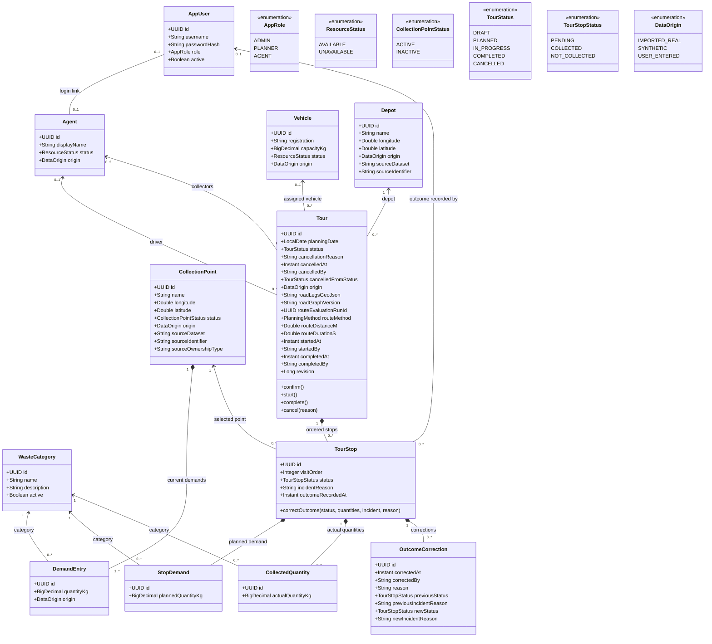

# Operational-domain class diagram

## 1. Scope

This diagram models the operational domain selected in D-033. It includes current collection
demand and the planned/actual values retained on tours. It deliberately excludes candidate
optimization solutions, evaluation-result entities, controllers, DTOs, repositories, and UI
classes. The optimization sequence is documented separately in `03-sequence-optimize-tour.md`.

A `TourStop` contains **planned demand snapshots**, so later edits to a collection point's current
`DemandEntry` records do not rewrite confirmed tours or history. `roadLegsGeoJson` is the accepted
operational tour's road-following leg collection, not a straight line between stop markers. It is
copied from a retained evaluation run of the tour's current revision. Accepting the NN + 2-opt
proposal gives the proposal's legs; keeping the input order gives the input-order legs.
`routeEvaluationRunId` and `routeMethod` identify that run and method without making evaluation
results part of this diagram (D-033). Any change of stops, order or depot clears the route.
`Tour.revision` counts structural draft changes so that an evaluation run can prove it
used the tour's current inputs (S5/S6). `startedAt`/`startedBy` and `completedAt`/`completedBy`
record who started and completed the tour (usernames, UTC); a stop's outcome records its actor
and time (S7).
A cancelled tour keeps who cancelled it, when, why and from which status
(`cancelledFromStatus`). An `OutcomeCorrection` retains the previous and the corrected outcome of
a stop, including the previous and new category quantities (category name and kilograms, stored
as value lists), the correcting user, the UTC time and the reason; the stop's
`outcomeRecordedAt` keeps the original recording (S8). Audit events (US-39) are a cross-cutting
log outside this operational diagram (D-033).

## 2. Diagram



## 3. Multiplicity and lifecycle reading

- An agent/user link is optional at both ends, but a linked account must have the `AGENT` role.
- A draft may temporarily have no vehicle, driver, or stops. Once `PLANNED` or `IN_PROGRESS`, it
  has one vehicle, one driver, zero to two collectors, and at least one stop. A completed tour
  retains those references.
- A tour can serve mixed waste categories. `StopDemand.plannedQuantityKg` values are summed across
  every stop and category for the single vehicle-capacity check; there are no compartments.
- A stop starts as `PENDING`. `COLLECTED` requires actual category quantities;
  `NOT_COLLECTED` requires an incident/reason. Both are terminal outcomes for completion.
- `CANCELLED` is terminal and retains whatever stops/results existed when the draft, planned, or
  in-progress tour was cancelled. It is not a hard deletion.
- A stop has zero or more corrections, oldest first. Corrections are allowed
  only on recorded outcomes of `IN_PROGRESS`, `COMPLETED` or `CANCELLED` tours and never return a
  stop to `PENDING`.

## 4. OCL constraints

The following OCL uses association-end names implied by the diagram (`demands`, `stops`,
`stopDemands`, `actualQuantities`, `vehicle`, `driver`, `collectors`, `agent`, and
`outcomeRecordedBy`, `tour` and `corrections`). These are design constraints to implement and test, not claims about code
that already exists.

### 4.1 Location, demand, and provenance

```ocl
context CollectionPoint
inv ValidLongitude:
  longitude >= -180.0 and longitude <= 180.0
inv ValidLatitude:
  latitude >= -90.0 and latitude <= 90.0
inv HasCurrentDemand:
  demands->notEmpty()
inv ImportedPointHasSource:
  origin = DataOrigin::IMPORTED_REAL implies
    (sourceDataset <> null and sourceDataset.size() > 0 and
     sourceIdentifier <> null and sourceIdentifier.size() > 0)

context Depot
inv ValidLongitude:
  longitude >= -180.0 and longitude <= 180.0
inv ValidLatitude:
  latitude >= -90.0 and latitude <= 90.0

context DemandEntry
inv PositiveDemand:
  quantityKg > 0

context StopDemand
inv PositivePlannedDemand:
  plannedQuantityKg > 0

context CollectedQuantity
inv NonNegativeActualQuantity:
  actualQuantityKg >= 0

context Vehicle
inv PositiveCapacity:
  capacityKg > 0
```

### 4.2 Account and crew integrity

```ocl
context AppUser
inv LinkedAccountIsAgent:
  agent->notEmpty() implies role = AppRole::AGENT

context Tour
inv AtMostTwoCollectors:
  collectors->size() <= 2
inv DriverIsNotCollector:
  driver->notEmpty() implies collectors->excludes(driver)
inv ResourcesRequiredAfterDraft:
  (status = TourStatus::PLANNED or
   status = TourStatus::IN_PROGRESS or
   status = TourStatus::COMPLETED) implies
    (vehicle->notEmpty() and driver->notEmpty() and stops->notEmpty())
inv CapacityRespectedAfterDraft:
  (status = TourStatus::PLANNED or
   status = TourStatus::IN_PROGRESS or
   status = TourStatus::COMPLETED) implies
    stops.stopDemands.plannedQuantityKg->sum() <= vehicle.capacityKg
inv PlannedTourHasVersionedRoadRoute:
  (status = TourStatus::PLANNED or
   status = TourStatus::IN_PROGRESS or
   status = TourStatus::COMPLETED) implies
    (roadLegsGeoJson <> null and roadLegsGeoJson.size() > 0 and
     roadGraphVersion <> null and roadGraphVersion.size() > 0)
```

The `0..1` association ends enforce the optional one-to-one agent/account link. The `0..2`
collectors end and `DriverIsNotCollector` together enforce a distinct small crew.

### 4.3 Stop order and outcomes

```ocl
context Tour
inv UniqueContiguousVisitOrder:
  stops->forAll(s |
    s.visitOrder >= 1 and s.visitOrder <= stops->size()) and
  stops->forAll(a, b |
    a <> b implies a.visitOrder <> b.visitOrder)

context TourStop
inv CollectedOutcomeComplete:
  status = TourStopStatus::COLLECTED implies
    (actualQuantities->notEmpty() and
     outcomeRecordedBy->notEmpty() and outcomeRecordedAt <> null)
inv NotCollectedReasonRequired:
  status = TourStopStatus::NOT_COLLECTED implies
    (incidentReason <> null and incidentReason.size() > 0 and
     outcomeRecordedBy->notEmpty() and outcomeRecordedAt <> null)
inv PendingHasNoRecordedOutcome:
  status = TourStopStatus::PENDING implies
    (actualQuantities->isEmpty() and outcomeRecordedAt = null)

context OutcomeCorrection
inv CorrectionReasonGiven:
  reason <> null and reason.size() > 0
inv TerminalBeforeAndAfter:
  (previousStatus = TourStopStatus::COLLECTED or previousStatus = TourStopStatus::NOT_COLLECTED) and
  (newStatus = TourStopStatus::COLLECTED or newStatus = TourStopStatus::NOT_COLLECTED)
```

### 4.4 Lifecycle operations

```ocl
context Tour::confirm()
pre DraftOnly:
  status = TourStatus::DRAFT
pre CompleteValidPlan:
  vehicle->notEmpty() and driver->notEmpty() and stops->notEmpty() and
  vehicle.status = ResourceStatus::AVAILABLE and
  driver.status = ResourceStatus::AVAILABLE and
  collectors->forAll(status = ResourceStatus::AVAILABLE) and
  stops.stopDemands.plannedQuantityKg->sum() <= vehicle.capacityKg
pre VersionedRoadRoute:
  roadLegsGeoJson <> null and roadLegsGeoJson.size() > 0 and
  roadGraphVersion <> null and roadGraphVersion.size() > 0
post Planned:
  status = TourStatus::PLANNED

context Tour::start()
pre PlannedOnly:
  status = TourStatus::PLANNED
pre ResourcesStillAvailable:
  vehicle.status = ResourceStatus::AVAILABLE and
  driver.status = ResourceStatus::AVAILABLE and
  collectors->forAll(status = ResourceStatus::AVAILABLE)
pre PointsStillActive:
  stops->forAll(s | s.collectionPoint.status = CollectionPointStatus::ACTIVE)
pre VersionedRoadRoute:
  roadLegsGeoJson <> null and roadGraphVersion <> null
post InProgress:
  status = TourStatus::IN_PROGRESS and startedAt <> null

context Tour::complete()
pre ActiveOnly:
  status = TourStatus::IN_PROGRESS
pre EveryStopTerminal:
  stops->notEmpty() and
  stops->forAll(status = TourStopStatus::COLLECTED or
                status = TourStopStatus::NOT_COLLECTED)
post Completed:
  status = TourStatus::COMPLETED and completedAt <> null

context Tour::cancel(reason : String)
pre NotAlreadyTerminal:
  status = TourStatus::DRAFT or status = TourStatus::PLANNED or
  status = TourStatus::IN_PROGRESS
pre ReasonGiven:
  reason <> null and reason.size() > 0
post Cancelled:
  status = TourStatus::CANCELLED and cancellationReason = reason and
  cancelledAt <> null and cancelledFromStatus = status@pre

context TourStop::correctOutcome(newStatus : TourStopStatus, reason : String)
pre RecordedOutcome:
  status = TourStopStatus::COLLECTED or status = TourStopStatus::NOT_COLLECTED
pre ExecutedTour:
  tour.status = TourStatus::IN_PROGRESS or tour.status = TourStatus::COMPLETED or
  tour.status = TourStatus::CANCELLED
pre ReasonGiven:
  reason <> null and reason.size() > 0
post CorrectionRetained:
  corrections->size() = corrections@pre->size() + 1 and status = newStatus
```

`confirm()` and `start()` also require authorization and all resource/point validations described
in US-25 and US-27. OCL expresses the domain rules; it does not replace backend authorization or
transaction boundaries.
