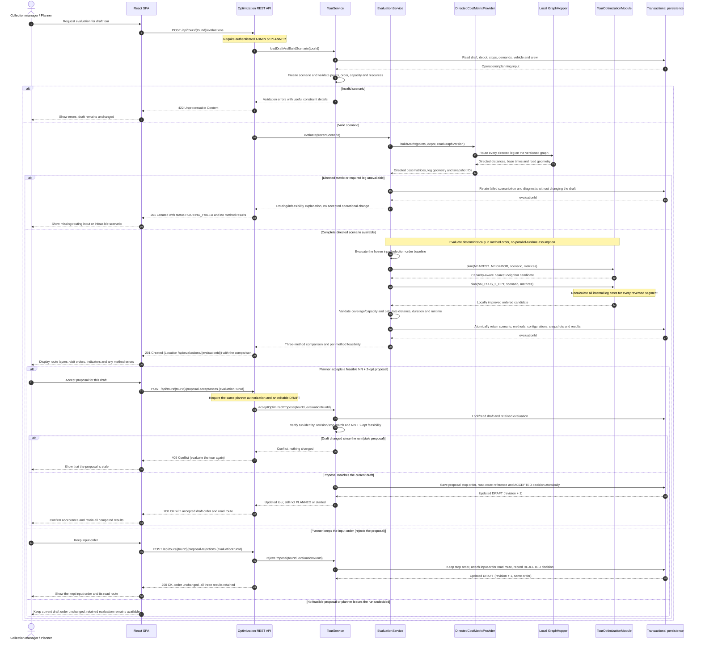

# Sequence diagram — Evaluate, review, and accept a tour proposal

## 1. Scenario

This is the core intelligent-planning scenario for UC10 and UC11 (US-21–US-24). A planner has
already created a `DRAFT`, selected its stops/input order, and assigned a vehicle and crew. The
planner requests a three-method comparison, inspects feasible results, and either applies the
NN + 2-opt proposal to that same draft or keeps the input order. Both decisions are refused when
the draft changed since the run.

The diagram distinguishes:

- the **operational draft**, which must not be changed merely by running an evaluation;
- the **frozen planning scenario**, shared identically by all three methods;
- **retained evaluation results**, including failures and rejected proposals; and
- **planner acceptance**, which is a separate, authorized operation.

GraphHopper and the optimization module are participants in this behavioral view even though they
are intentionally excluded from the operational-domain class diagram (D-033).

## 2. Diagram

## 3. Main postconditions and alternatives

### Successful evaluation

- The scenario and all method outcomes are retained with source/road snapshots and algorithm
  configuration, even when the planner later rejects the proposal.
- Every feasible candidate starts/ends at the depot and covers exactly the same selected points.
  Capacity and coverage are revalidated after improvement.
- Distance, estimated duration, and execution time are calculated under common rules. No global
  optimality or numerical improvement is assumed.

### Accepted proposal

- Acceptance applies only the identified feasible NN + 2-opt order and road-route reference to the
  matching editable draft.
- The tour remains `DRAFT`; US-25/UC12 must separately validate and confirm it as `PLANNED`.
- Updating the operational draft and recording the decision on the retained run occur in one
  transaction. The same transaction writes the `PROPOSAL_ACCEPTED` audit event (S8, US-39).
- A proposal whose run revision or stop list differs from the current draft is stale. It is
  refused with 409 and changes nothing.

### Failure or rejection

- If the road snapshot itself cannot be loaded (missing or checksum mismatch), the API answers 503 and retains nothing.
- Invalid inputs, unavailable directed legs, or optimization failures never produce a partially
  accepted tour and never corrupt existing operational data.
- Keeping the input order (rejecting the proposal) leaves the draft order unchanged, attaches
  the input-order road route of the same run (needed for confirmation), and retains all three
  results. Leaving the run undecided changes nothing.
- NYC DOT traffic is absent from this sequence by design: it is a display overlay, not a cost
  input or automatic rerouting trigger.

## 4. Confirmation (UC12, US-25)

`POST /api/tours/{tourId}/confirmation` revalidates the structural issues, the planning date
and the road route (`ROUTE_MISSING`/`ROUTE_OUTDATED`). It answers 422 with the list of
blocking issues, or 200 with the tour `PLANNED`. After that, every structural edit,
evaluation and proposal decision answers 409.
