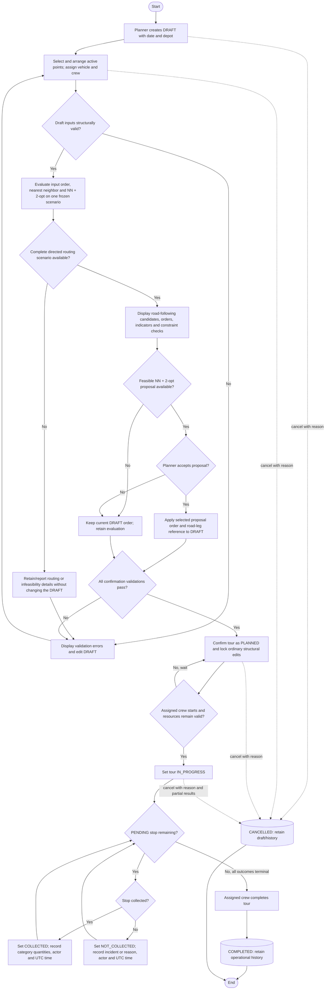

# Activity diagram — Tour planning and execution lifecycle

## 1. Purpose

This activity covers UC08–UC19: draft preparation, three-method evaluation, planner review,
confirmation, assigned-crew execution, completion, and cancellation. It implements the lifecycle
chosen in D-025 and the terminal stop outcomes in D-031.

The main path shows an accepted optimized proposal. Rejecting the proposal does not block the
planner from confirming an otherwise valid draft with its current input order.

## 2. Diagram

## 3. Guards and state rules

| Transition or state | Rule |
|---|---|
| `DRAFT → PLANNED` | Revalidate stops/order, active points, road route, one available vehicle, one available driver, zero to two distinct available collectors, and total mixed-category demand within capacity. |
| `PLANNED → IN_PROGRESS` | Only an assigned crew member may start the tour; resource availability is checked again. “No, wait” leaves it `PLANNED` and does not silently change resources. |
| `PENDING → COLLECTED` | The assigned driver or either collector records non-negative actual quantities by waste category, actor, and UTC time. |
| `PENDING → NOT_COLLECTED` | The assigned driver or either collector records a non-blank incident/reason, actor, and UTC time. |
| `IN_PROGRESS → COMPLETED` | Every stop must be `COLLECTED` or `NOT_COLLECTED`; the full route, resources, outcomes, and results are retained. |
| `DRAFT/PLANNED/IN_PROGRESS → CANCELLED` | A planner supplies a reason. Existing stop results are retained, and cancellation is not deletion. |
| Terminal states | `COMPLETED` and `CANCELLED` have no ordinary execution transition. A privileged result correction uses the separate audited operation in US-31. |

There is intentionally no automatic `PLANNED → DRAFT` transition and no optimizer-driven start,
completion, or rerouting. If a confirmed tour can no longer be executed, the planner uses the
documented cancellation path rather than bypassing lifecycle validation.
