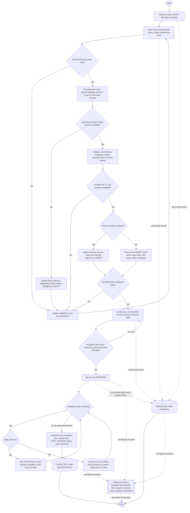

# Activity diagram — Tour planning and execution lifecycle

## 1. Purpose

This activity covers UC08–UC19: draft preparation, three-method evaluation, planner review,
confirmation, assigned-crew execution, completion, and cancellation. It implements the lifecycle
chosen in D-025 and the terminal stop outcomes in D-031. Execution (start, stop outcomes,
completion) is implemented in S7 for the assigned crew only. Cancellation and privileged outcome
corrections by planners are implemented in S8; every step is recorded in the audit log.

The main path shows an accepted optimized proposal. Keeping the input order (rejecting
the proposal) attaches the input-order road route of the same run, so an otherwise valid
draft can still be confirmed in its current order.

## 2. Diagram

## 3. Guards and state rules

| Transition or state | Rule |
|---|---|
| `DRAFT → PLANNED` | Revalidate stops/order, active and eligible points, one available vehicle, one available driver, zero to two distinct available collectors, total mixed-category demand within capacity, a planning date not in the past, and a road route from a retained run of the current draft whose stop and depot coordinates are unchanged (`ROUTE_MISSING`, `ROUTE_OUTDATED`). Any failure returns the blocking issues and the tour stays `DRAFT`. |
| `DRAFT` route reference | Set only by accepting the NN + 2-opt proposal or keeping the input order of a completed, current run. Cleared by any change of stops, order or depot; a stale run (other revision) is refused. A failed or infeasible run cannot provide a route, so the planner corrects the draft and evaluates again. |
| `PLANNED → IN_PROGRESS` | Only an assigned crew member (driver or collector with a linked, active `AGENT` account) may start, and only a `PLANNED` tour. The start rechecks the structural issues (vehicle, driver and collectors available, points active and eligible, capacity) and the road route (`ROUTE_MISSING`, `ROUTE_OUTDATED`); any failure returns the blocking issues (for example `INACTIVE_STOP`, `VEHICLE_UNAVAILABLE`) and the tour stays `PLANNED` (“No, wait”). The planning date is not checked. Nothing is rechecked after the start. |
| `PENDING → COLLECTED` | The assigned driver or either collector records non-negative actual quantities by waste category, actor, and UTC time. |
| `PENDING → NOT_COLLECTED` | The assigned driver or either collector records a non-blank incident/reason, actor, and UTC time. |
| `IN_PROGRESS → COMPLETED` | Every stop must be `COLLECTED` or `NOT_COLLECTED`; the full route, resources, outcomes, and results are retained; otherwise the completion is refused with one `STOP_PENDING` issue per pending stop. |
| `DRAFT/PLANNED/IN_PROGRESS → CANCELLED` | A planner or administrator supplies a non-blank reason (at most 500 characters). The tour keeps its stops, pending and recorded stop states, quantities, crew and route, plus who cancelled it, when (UTC) and from which status. Cancellation is not deletion; a completed or cancelled tour cannot be cancelled (409). The crew still sees a cancelled tour that had been planned or started, never a cancelled draft. |
| Terminal states | `COMPLETED` and `CANCELLED` have no ordinary execution transition. A planner or administrator may correct a recorded (`COLLECTED` or `NOT_COLLECTED`) outcome of an `IN_PROGRESS`, `COMPLETED` or `CANCELLED` tour through the dedicated correction operation (US-31): a reason is required, the previous values, actor and UTC time are retained, an audit event is written, the tour status does not change and a stop never returns to `PENDING`. |
| Audit | Every completed transition (create, edits, evaluation, accept/keep, confirm, start, outcome, completion, cancellation, correction) writes one audit event with actor, UTC time and outcome (US-39); refused transitions write none. |

There is intentionally no automatic `PLANNED → DRAFT` transition and no optimizer-driven start,
completion, or rerouting. If a confirmed tour can no longer be executed, the planner uses the
documented cancellation path rather than bypassing lifecycle validation.
