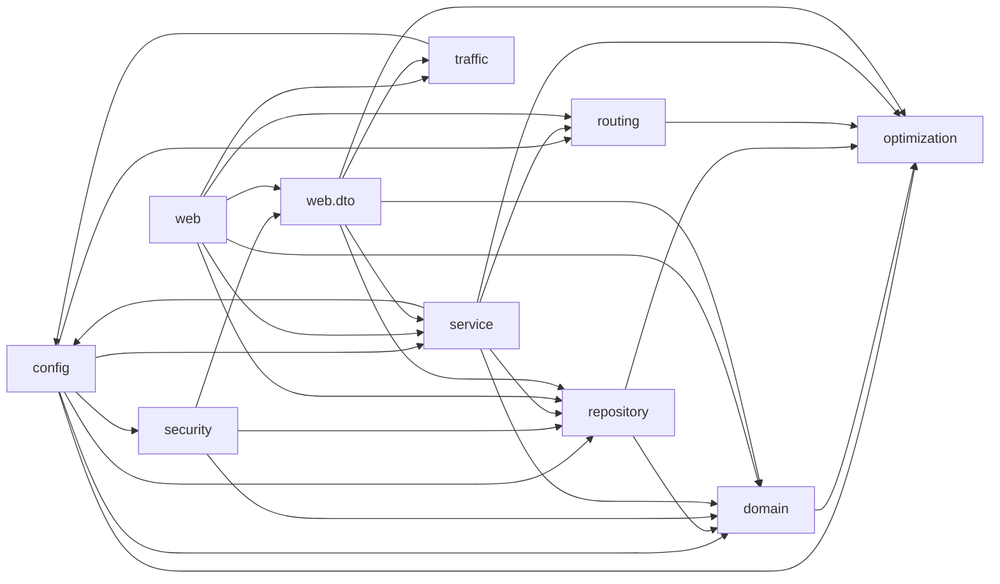
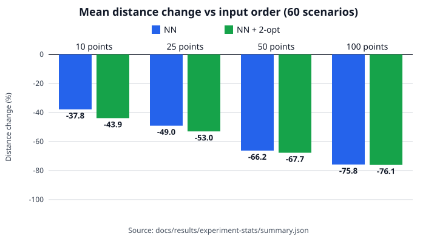

# Part 6 — Software metrology and research answer

This document answers Part 6 of the assignment: software metrics of the prototype, and the
research question of Part 2 answered with measured data. Every number below is copied from a
file generated in sprint S10 and committed under [`results/`](results/) (code metrics:
`results/metrics/`; experiment: `results/experiment/` and `results/experiment-stats/`). Nothing
was typed by hand; the commands that regenerate each file are in section 2 and in the table
captions.

## 1. Summary

- **Size.** The Java backend is 239 source files with 11251 source lines of code (SLOC); its tests
  are 70 files with 10172 SLOC. The own TypeScript frontend is 93 files with 9308 SLOC; the 24
  vendored shadcn/ui files (2078 SLOC) are excluded from own code. The compiled backend has 273
  class files (239 top-level, 34 nested) and 2432 methods.
- **Complexity.** The mean cyclomatic complexity (CC) of 897 Java methods is 2.18 (median 1.00,
  90th percentile 4); 33 methods (3.68 %) reach the classic threshold of 10 and the maximum is 39
  (`ScenarioCsvImportService.checkRow`). The TypeScript functions (709) have a mean of 2.26 and 27
  (3.81 %) reach 10.
- **Hot spots.** `TourService`, `Tour`, `ScenarioCsvImportService`, `DemoDataService`,
  `TourStop` and `TrafficSnapshotParser` recur in the complexity, coupling and PMD lists
  (section 3.7). They are the modules that most deserve architectural work.
- **Architecture.** `optimization/` has no internal dependency (Ce internal 0) and depends on
  `java.*` only, as `OptimizationIndependenceTest` enforces. JDepend also finds a dependency
  cycle through `config/` between `config`, `security`, `service`, `traffic` and `web.dto`.
- **Code smells.** PMD reports 133 violations in 35 files; 75 are in `service/`.
- **Research answer.** On the 60 seeded MN01 scenarios (20 distinct routing instances) NN + 2-opt
  reduced the directed road distance against the input order by -60.18 % on average and the
  estimated duration by -10.88 %, with full coverage and no capacity violation. Against NN alone
  the 2-opt step gave a further -5.58 % on average; it improved 17 of the 20 instances and was
  never worse (exact Wilcoxon p = 1.53e-05).
- **Cost.** The sequencing step takes a median of 0.021 ms for NN + 2-opt over all sizes (maximum
  1.989 ms); this timer excludes the road matrix (section 5.4).
- **Limits.** The baseline is a random shuffle, the demand is synthetic, one district and one
  vehicle are studied, and traffic is not part of the costs (section 7).

## 2. How to reproduce

```bash
# code metrics (about 15 s); --publish also copies the summaries to docs/results/metrics/
bash tools/metrics.sh --publish

# experiment: 60 scenarios x 3 repetitions = 180 runs = 540 rows (about 2 minutes)
bash tools/run-experiment.sh metrics/experiment --wastems.experiment.repetitions=3 \
     --wastems.experiment.label="S10 canonical campaign"
mkdir -p docs/results/experiment
cp metrics/experiment/{results.csv,scenarios.csv,batch.json,run-info.txt,run.log} docs/results/experiment/

# statistics, tables and chart
python3 tools/experiment-stats.py docs/results/experiment docs/results/experiment-stats
python3 tools/experiment-stats.py --self-test
```

The database and the road-graph cache that the runner also writes under `metrics/experiment/` are
not committed. Distances, durations and visit orders are deterministic (section 5.1), so a re-run
reproduces them exactly; only execution times, identifiers and timestamps differ.

| Tool | Version and role |
|---|---|
| `tools/count-loc.py` | Language-aware line counter (SLOC, comments, blanks) |
| CKJM extended | `ckjm_ext` `2.10` through `~/.local/bin/ckjm`: WMC, DIT, NOC, CBO, RFC, LCOM, LCOM3 on the bytecode |
| PMD | `7.17.0` through `maven-pmd-plugin` `3.28.0`: cyclomatic complexity and code smells (`tools/pmd/`) |
| JDepend | `guru.nidi:jdepend` `2.9.5` inside `jdepend-maven-plugin` `2.1`: package coupling |
| oxlint | the `eslint/complexity` rule (`tools/oxlint-complexity.json`): TypeScript complexity |
| `tools/experiment-stats.py` | Python 3 standard library: checks, statistics, exact Wilcoxon test, chart |
| GraphHopper | `11.1`, profile `car`, embedded in the backend (routing for the experiment) |

The maintained JDepend fork is needed because JDepend `2.9.1` cannot read Java 21 class files
(it reported `Unknown constant: 18` and silently analysed only 90 of 273 class files);
`tools/metrics.sh` now fails when that message appears (D-051).

Environment of the committed results:


```text
commit: 4b6f56b3e5b3e1b307d12c72dcf6a6c263c8f2b6
tracked_changes: 0
date_utc: 2026-11-02T02:48:54Z
java: openjdk version "21.0.13" 2026-10-20 LTS
maven: Apache Maven 3.9.16 (2bdd9fddda4b155ebf8000e807eb73fd829a51d5)
node: v26.13.0
oxlint: Version: 1.90.0
```

```text
commit: 5b2e9cf9d3fbb9fad3e5e6fbdf7508b10156c4b7
tracked_changes: 0
started_utc: 2026-11-02T02:46:41Z
java: openjdk version "21.0.13" 2026-10-20 LTS
os: Linux 7.2.6-76070206-generic x86_64
cpus: 8
args: --wastems.experiment.repetitions=3 --wastems.experiment.label=S10 canonical campaign
finished_utc: 2026-11-02T02:48:24Z
exit: 0
```

## 3. Code metrics

Scope: the Java backend (`backend/src/main/java`) for all object-oriented metrics, because CKJM,
PMD and JDepend analyse Java; for the TypeScript frontend only size and cyclomatic complexity
are measured. The vendored shadcn/ui components (`frontend/src/components/ui/`) are not own code
and are excluded everywhere, as `AGENTS.md` prescribes.

### 3.1 Size (LOC, classes, methods)

Source: `results/metrics/loc-java-main.txt`, `loc-java-test.txt`, `loc-frontend-own.txt`,
`loc-frontend-vendored.txt`, `ckjm-summary.txt`; regenerate with `bash tools/metrics.sh`.

| Code | Files | SLOC | Comment lines | Blank lines |
|---|---|---|---|---|
| Java main | 239 | 11251 | 677 | 1681 |
| Java test | 70 | 10172 | 63 | 1070 |
| TypeScript own (`.ts`, `.tsx`) | 93 | 9308 | 246 | 579 |
| TypeScript vendored (excluded) | 24 | 2078 | 1 | 178 |

SLOC of the main Java code per package (`loc-java-main.txt`):


```text
group                                             files     sloc  comments  blanks
----------------------------------------------------------------------------------
backend/src/main/java/com/ase/wastems                 1       11         6       3
backend/src/main/java/com/ase/wastems/config         13      558        51      73
backend/src/main/java/com/ase/wastems/domain         36     2521       163     583
backend/src/main/java/com/ase/wastems/optimization     11      355        50      51
backend/src/main/java/com/ase/wastems/repository     14      304        14      81
backend/src/main/java/com/ase/wastems/routing        10      334        30      59
backend/src/main/java/com/ase/wastems/security        4      128         7      20
backend/src/main/java/com/ase/wastems/service        57     4424       216     436
backend/src/main/java/com/ase/wastems/traffic        11      365        25      37
backend/src/main/java/com/ase/wastems/web            17     1089        40     160
backend/src/main/java/com/ase/wastems/web/dto        65     1162        75     178
----------------------------------------------------------------------------------
TOTAL                                               239    11251       677    1681
```

Compiled backend (`ckjm-summary.txt`, section `## Totals`):


```text
class files: 273
top-level classes: 239
nested classes: 34
methods (sum of WMC): 2432
```

The 34 nested classes are records, enums and helper types declared inside another type. The
frontend has 709 functions (named and anonymous) in the complexity report (section 3.2).

### 3.2 Cyclomatic complexity

Source: `results/metrics/pmd-summary.txt` (Java, PMD `CyclomaticComplexity` with
`methodReportLevel` 1 in `tools/pmd/wastems-cc-all.xml`) and `ts-complexity-summary.txt`
(TypeScript, oxlint); regenerate with `bash tools/metrics.sh`. CC is the number of decision points
plus one. A value of 10 is McCabe's classic limit and PMD's default report level, so the methods
at or above 10 are listed as hot spots.

Java, all methods and constructors:


```text
methods: 897
mean: 2.18
median: 1.00
p90: 4
max: 39 (ScenarioCsvImportService.checkRow)
>= 10: 33 (3.68 %)
bucket 1: 680 (75.81 %)
bucket 2: 57 (6.35 %)
bucket 3-4: 71 (7.92 %)
bucket 5-9: 56 (6.24 %)
bucket 10-19: 23 (2.56 %)
bucket >= 20: 10 (1.11 %)
```

Java, per package:

```text
package          methods    mean  median  max  >= 10
(root)                 1    1.00    1.00    1      0
config                29    1.55    1.00    6      0
domain               325    1.40    1.00   33      2
optimization          25    4.00    1.00   18      5
repository            53    1.00    1.00    1      0
routing               36    2.17    1.00   14      2
security               8    1.62    1.00    6      0
service              253    3.55    2.00   39     19
traffic               14    6.71    3.00   27      3
web                  108    1.36    1.00   14      1
web.dto               45    1.69    1.00   12      1
```

Java, every method with CC of at least 10 (the hot spots):

```text
 39  ScenarioCsvImportService.checkRow
 33  TourStop.correctOutcome
 32  ExperimentSpec.of
 29  DemoDataService.advance
 27  ScenarioCsvImportService.importCsv
 27  TrafficSnapshotParser.parse
 25  TourService.assign
 25  TrafficSnapshotParser.classify
 20  EvaluationExportService.appendRows
 20  ScenarioCsvImportService.crossChecks
 18  PlanningScenario.PlanningScenario
 17  SimpleCsv.records
 17  TourService.decidableResult
 15  DemoDataService.load
 14  AuditEventController.search
 14  GraphHopperRoadRouter.init
 14  Tour.structuralIssues
 13  ArrayCostMatrix.copyValidated
 13  EvaluationAggregates.addGroup
 13  Mn01ImportService.importBaskets
 13  TwoOptImprovement.improve
 12  DemoDataService.doCreateTour
 12  RoadNetworkMatrixProvider.buildMatrix
 12  StopOutcomeRequest.validateOutcome
 12  TourOptimizationModule.plan
 11  EvaluationExportService.scenariosCsv
 11  ExperimentService.run
 11  NearestNeighborConstruction.construct
 11  ScenarioCsvImportService.header
 10  DemoDataService.recordOutcomes
 10  PolylineDecoder.decode
 10  TourService.correctOutcome
 10  TourService.loadDraftAndBuildScenario
count: 33
```

Java, classes by total complexity:

```text
class                                            total highest
service.ScenarioCsvImportService                   131      39
service.TourService                                126      25
service.DemoDataService                            110      29
domain.Tour                                        107      14
domain.TourStop                                     83      33
traffic.TrafficSnapshotParser                       72      27
service.Mn01ImportService                           49      13
service.EvaluationExportService                     48      20
domain.EvaluationRun                                47       4
domain.EvaluationBatch                              41       3
```

Reading: three quarters of the methods have a complexity of 1 (accessors, delegations, record
members). The long tail is guard-heavy code: input validation (`ScenarioCsvImportService.checkRow`,
`TourStop.correctOutcome`, `ExperimentSpec.of`), the scripted demonstration (`DemoDataService`)
and the traffic snapshot parser. In `optimization/` five of 25 methods reach 10; this is
algorithmic branching (constructor validation, nearest-neighbour selection, 2-opt search).

TypeScript (own code, all functions):


```text
functions: 709
named: 296
mean: 2.26
median: 1.00
p90: 5
max: 32 (src/pages/tour-planner-page.tsx:39 TourPlannerPage)
>= 10: 27 (3.81 %)
bucket 1: 465 (65.59 %)
bucket 2: 103 (14.53 %)
bucket 3-4: 65 (9.17 %)
bucket 5-9: 49 (6.91 %)
bucket 10-19: 23 (3.24 %)
bucket >= 20: 4 (0.56 %)
```

TypeScript per directory and the most complex functions:

```text
directory                            functions    mean  max  >= 10
src                                          4    2.50    3      0
src/components/agents                       13    3.00    8      0
src/components/collection-points            50    2.52   19      2
src/components/evaluations                  58    2.26   12      3
src/components/execution                    44    2.27   19      1
src/components/fleet                         5    4.60    8      0
src/components/maps                         54    2.06   12      2
src/components/shared                        5    4.60   15      1
src/components/tours                       123    2.20   26      4
src/hooks                                  133    1.29    5      0
src/lib                                     34    2.88    9      0
src/pages                                  186    2.69   32     14
```
```text
## Top 10 functions
 cc  location
 32  src/pages/tour-planner-page.tsx:39 TourPlannerPage
 26  src/components/tours/evaluation-panel.tsx:18 EvaluationPanel
 22  src/pages/collection-points-page.tsx:35 CollectionPointsPage
 20  src/pages/evaluation-explorer-page.tsx:37 EvaluationExplorerPage
 19  src/components/collection-points/point-form.tsx:60 PointForm
 19  src/components/execution/tour-execution-panel.tsx:25 TourExecutionPanel
 17  src/components/tours/proposal-actions.tsx:9 ProposalActions
 16  src/pages/history-page.tsx:41 HistoryPage
 15  src/components/shared/app-shell.tsx:18 AppShell
 13  src/components/collection-points/point-form.tsx:207 (anonymous)
```

The complex frontend functions are page and panel components that combine data loading, forms and
conditional rendering (`TourPlannerPage`, `EvaluationPanel`, `CollectionPointsPage`).

### 3.3 Coupling (CBO, RFC, package dependencies)

Source: `results/metrics/ckjm-summary.txt` and `jdepend-summary.txt`; regenerate with
`bash tools/metrics.sh`. CBO (coupling between objects) counts the other classes a class uses or
is used by; RFC (response for a class) counts the methods that can run in response to a message.
JDepend metrics per package: **Ca** afferent coupling (packages that depend on this one), **Ce**
efferent coupling (packages this one depends on, including libraries), **A** abstractness (share of
abstract classes), **I** instability (`Ce / (Ca + Ce)`), **D** distance from the main sequence
(`|A + I - 1|`).

Class-level coupling, per package means (`## Per package`):


```text
package            classes      WMC      DIT      NOC      CBO      RFC     LCOM    LCOM3
-----------------------------------------------------------------------------------------
(root)                   1     2.00     1.00     0.00     2.00     4.00     1.00     2.00
config                  13     6.00     1.31     0.00    11.31    20.54    15.00     0.85
domain                  36    11.61     1.44     0.00    12.11    19.42    97.92     0.82
optimization            13     4.31     1.46     0.00     6.00    11.85     9.08     1.40
repository              14     6.36     1.14     0.00     7.43     6.93    26.79     1.85
routing                 11     5.82     1.91     0.00     8.36    17.55     9.27     1.02
security                 4     2.25     1.50     0.00    11.50    15.25     0.25     0.12
service                 78     8.74     1.94     0.05    10.86    31.90    49.81     0.99
traffic                 12     7.25     1.67     0.00     6.33    17.83    23.75     1.02
web                     17     7.00     1.00     0.00    12.82    30.12    11.47     0.29
web.dto                 74    11.19     2.00     0.00     6.08    21.95    68.36     0.82
```

Classes with the highest CBO:

```text
class                                                        WMC     DIT     NOC     CBO     RFC    LCOM   LCOM3
----------------------------------------------------------------------------------------------------------------
service.DemoDataService                                       30       1       0      67     222     311  0.9321
config.SecurityConfig                                         15       1       0      55      75     105     2.0
service.TourService                                           54       1       0      53     270    1243  0.9036
service.EvaluationService                                     17       1       0      43     122     108  0.8125
service.ScenarioCsvImportService                              23       1       0      42     183     227  0.9502
service.ExperimentService                                     12       1       0      41     123      26   0.843
routing.GraphHopperRoadRouter                                  9       1       0      35      99      16  0.4821
service.TourExecutionService                                  24       1       0      34     113     236  0.9022
service.AuditService                                          14       1       0      33      47      61  0.8846
web.EvaluationController                                      15       1       0      33      84      57  0.8265
service.Mn01ImportService                                     12       1       0      27     105      46  0.9576
web.ApiExceptionHandler                                       17       1       0      25      53     136     2.0
domain.Tour                                                   61       1       0      24     128    1378  0.9308
web.AuthController                                             5       1       0      24      30       2  0.7083
web.TourController                                            17       1       0      23      71       0  0.0625
```

Packages (JDepend):

```text
package        classes abstract   Ca   Ce Ce internal      A      I      D
--------------------------------------------------------------------------
(root)               1        0    0    4           0   0.00   1.00   0.00
config              13        0    2   47           6   0.00   0.96   0.04
domain              36        0    6   10           1   0.00   0.62   0.38
optimization        13        1    6    4           0   0.08   0.40   0.52
repository          14       12    5   11           2   0.86   0.69   0.54
routing             11        2    3   22           1   0.18   0.88   0.06
security             4        0    1   20           3   0.00   0.95   0.05
service             78        0    3   36           5   0.00   0.92   0.08
traffic             12        0    2   14           1   0.00   0.88   0.12
web                 17        0    0   29           6   0.00   1.00   0.00
web.dto             74        0    2   17           5   0.00   0.89   0.11
total classes: 273
```

Internal dependencies between the backend packages (only edges present in
`jdepend-summary.txt`; `(root)` has none):



Textual form and cycles:


```text
(root) -> (none)
config -> domain, optimization, repository, routing, security, service
domain -> optimization
optimization -> (none)
repository -> domain, optimization
routing -> optimization
security -> domain, repository, web.dto
service -> config, domain, optimization, repository, routing
traffic -> config
web -> domain, repository, routing, service, traffic, web.dto
web.dto -> domain, optimization, repository, service, traffic

## Cycles
strongly connected packages: config, security, service, traffic, web.dto
JDepend cycle path: config -> service -> config
JDepend cycle path: security -> web.dto -> service -> config -> service
JDepend cycle path: service -> config -> service
JDepend cycle path: traffic -> config -> service -> config
JDepend cycle path: web -> service -> config -> service
JDepend cycle path: web.dto -> service -> config -> service
```

The cycle exists because `config/` mixes two roles: the `*Properties` classes that `service/`
and `traffic/` read (`DemoProperties`, `ExperimentProperties`, `OptimizationProperties`,
`ServiceAreaProperties`) and the start-up runners that call `service/` and `security/`. Moving the
properties out of `config/` would remove the edges `service -> config` and `traffic -> config`
and with them the cycle; this is future work, not done (section 8).

### 3.4 Cohesion (LCOM)

Source: `results/metrics/ckjm-summary.txt`; regenerate with `bash tools/metrics.sh`. LCOM is the
Chidamber-Kemerer lack of cohesion (method pairs sharing no field minus pairs sharing one, floored
at zero); LCOM3 is the Henderson-Sellers variant, where values around 1 or above mean that the
methods hardly share fields. See the per-package table in section 3.3 and:


```text
class                                                        WMC     DIT     NOC     CBO     RFC    LCOM   LCOM3
----------------------------------------------------------------------------------------------------------------
domain.Tour                                                   61       1       0      24     128    1378  0.9308
service.TourService                                           54       1       0      53     270    1243  0.9036
domain.EvaluationRun                                          39       1       0      14      61     645  0.9406
web.dto.TourResponse                                          36       2       0      17      75     568  0.9429
web.dto.EvaluationRunResponse                                 35       2       0      14      81     541  0.9412
domain.EvaluationBatch                                        34       1       0      12      54     465   0.951
web.dto.EvaluationBatchResponse                               31       2       0       9      61     413  0.9333
web.dto.TourSummaryResponse                                   29       2       0      10      60     358  0.9286
domain.TourStop                                               32       1       0      20     100     340  0.8768
service.DemoDataService                                       30       1       0      67     222     311  0.9321
web.dto.EvaluationRunListItemResponse                         25       2       0      13      68     266  0.9167
web.dto.TourStopResponse                                      25       2       0       9      59     260  0.9167
service.TourExecutionService                                  24       1       0      34     113     236  0.9022
service.ScenarioCsvImportService                              23       1       0      42     183     227  0.9502
web.dto.TrafficOverlayResponse                                23       2       0      15      67     219  0.9091

note: WMC = number of methods (CKJM weight 1); records have DIT 2 (java.lang.Record).
```

LCOM is dominated by the classes with the most methods: JPA entities (`Tour`, `EvaluationRun`,
`EvaluationBatch`, `TourStop`) and response records (`TourResponse` and other DTOs). Their
methods are mostly accessors that each touch one field, so the number of method pairs without a
shared field grows with the square of the method count. High LCOM is therefore partly a
measurement artefact of data-carrying classes, not proof of a design defect. The classes where it
also coincides with a high WMC and high complexity (`Tour`, `TourService`) are the real candidates
for splitting. LCOM3 is highest for `config.SecurityConfig` and `web.ApiExceptionHandler`
(2.0), classes that hold almost no state, which is again an artefact of the definition.

### 3.5 Inheritance (DIT, NOC)

Source: `results/metrics/ckjm-summary.txt`; regenerate with `bash tools/metrics.sh`.


```text
DIT=1: 112
DIT=2: 147
DIT=3: 1
DIT=4: 9
DIT=5: 1
DIT=6: 3
```

The hierarchy is flat. The DIT of 2 is mostly records (they extend `java.lang.Record`) and most of
the remaining depth is exception types (`TourNotStartableException` has the maximum DIT, 6, through
the Spring and JDK exception chain). The mean NOC is 0.01 and the maximum is 3
(`TourIssuesException`): the code reuses behaviour by composition and Spring interfaces, not by
class inheritance, which is intended.

### 3.6 Code smells (PMD)

Source: `results/metrics/pmd-summary.txt` (quality ruleset `tools/pmd/wastems-ruleset.xml` plus the
PMD default ruleset); regenerate with `bash tools/metrics.sh`.


```text
total: 133
files: 35

## Violations by rule
rule                                category         count
CyclomaticComplexity                Design              38
NullAssignment                      Error Prone         14
NPathComplexity                     Design              13
TooManyMethods                      Design              13
ExcessiveImports                    Design              10
ExcessiveParameterList              Design               9
UselessPureMethodCall               Error Prone          9
CouplingBetweenObjects              Design               7
AssignmentInOperand                 Error Prone          4
TooManyFields                       Design               3
UnnecessaryImport                   Code Style           3
CompareObjectsWithEquals            Error Prone          2
EmptyCatchBlock                     Error Prone          2
NcssCount                           Design               2
PreserveStackTrace                  Best Practices       2
ReturnEmptyCollectionRatherThanNull Error Prone          2

## Violations by package
package          count
service             75
domain              26
traffic             13
web                  7
optimization         5
routing              5
config               1
web.dto              1

## Top 10 files
file                                                     count
service/ScenarioCsvImportService.java                       18
service/TourService.java                                    16
domain/Tour.java                                            12
service/DemoDataService.java                                11
traffic/TrafficSnapshotParser.java                          11
domain/EvaluationRun.java                                    5
service/EvaluationService.java                               5
domain/EvaluationBatch.java                                  4
service/EvaluationExportService.java                         4
service/Mn01ImportService.java                               4
```

Classification of the rules that fired:

- **Size and complexity:** `CyclomaticComplexity` (38: 33 methods and 5 classes), `NPathComplexity`,
  `TooManyMethods`, `TooManyFields`, `NcssCount`, `ExcessiveParameterList`.
- **Coupling:** `ExcessiveImports`, `CouplingBetweenObjects`.
- **Correctness and readability smells:** `NullAssignment`, `UselessPureMethodCall`,
  `AssignmentInOperand`, `CompareObjectsWithEquals`, `EmptyCatchBlock`, `PreserveStackTrace`,
  `ReturnEmptyCollectionRatherThanNull`, `UnnecessaryImport`.

Checked against the reported lines: the `NullAssignment` findings are mostly intentional field
resets in domain entities (`Tour.clearRoute`, `Agent.unlinkUserAccount`,
`EvaluationRun.failRouting`) and local resets in parsers; the `UselessPureMethodCall` findings are
`collection.size()` calls that deliberately force the initialisation of lazy JPA collections
(`TourService.initialized`, `EvaluationService.initialized`) and are false positives for that
purpose; the `AssignmentInOperand` findings are idiomatic `i++` and `counter++` inside expressions;
the `EmptyCatchBlock` in `Mn01ScenarioPool.load` carries a comment explaining that the importer skips
unparsable rows too. The size, complexity and coupling findings are the ones that point to real
maintainability work. Three `UnnecessaryImport` findings are trivial clean-ups that were not
fixed in this sprint, to keep the measured code identical to the code behind the experiment.

### 3.7 Interpretation: hot spots and architecture

**Which modules show the highest complexity and need architectural improvement?** The classes that
appear in several top lists are:

| Class | Evidence (sections 3.2 to 3.6) |
|---|---|
| `service.TourService` | WMC 54, CBO 53, RFC 270 (the maximum), LCOM 1243, total CC 126, 16 PMD violations |
| `domain.Tour` | WMC 61 (the maximum), LCOM 1378 (the maximum), total CC 107, 12 PMD violations |
| `service.ScenarioCsvImportService` | CC 39 in `checkRow` (the maximum), total CC 131 (the highest), CBO 42, 18 PMD violations (the most) |
| `service.DemoDataService` | CBO 67 (the maximum), total CC 110, `advance` CC 29, 11 PMD violations |
| `domain.TourStop` | `correctOutcome` CC 33, total CC 83 |
| `traffic.TrafficSnapshotParser` | `parse` CC 27, `classify` CC 25, total CC 72, 11 PMD violations |

`TourService` is the largest coordination point of the planning lifecycle (assignment, decisions,
confirmation, corrections, cancellation) and should be split by use case. `Tour` is the
aggregate root and carries the structural checks and route state; extracting the route and the
structural validation would reduce it. `ScenarioCsvImportService` and `DemoDataService` are
one-off data loaders with long guard chains rather than domain logic. By package, `service/` has
the most methods at or above 10 and the most violations.

**The intelligent module.** `optimization/` is the isolated core: its Ce internal is 0, its
external dependencies are `java.lang`, `java.lang.invoke`, `java.lang.runtime` and `java.util`
only, its A is 0.08, I is 0.40 and D is 0.52, and six packages depend on it (Ca 6).
`OptimizationIndependenceTest` enforces the rule on every build. The high D means that the package
is stable but almost entirely concrete, which is acceptable for a small algorithm library.
**The traffic overlay** depends only on `config` (the service-area properties), and the
only classes that reference it are `TrafficController` (in `web`) and `TrafficOverlayResponse` (in
`web.dto`), as `TrafficIsolationTest` enforces; it has no dependency on `optimization/`, `routing/`, `service/` or
`domain/`, which is the structural guarantee of D-021 that traffic never enters the costs.

## 4. Experiment design

**Research question** (`docs/02-literature-review.md` section 1): *To what extent does integrating an
intelligent tour-optimization module reduce total road-network travel distance and estimated
collection duration compared with a documented baseline, while satisfying the same vehicle-capacity
and collection-service constraints?*

**Methods** (D-008, D-046), all deterministic and run on the same frozen scenario and the same
directed cost matrix: `INPUT_ORDER` (the baseline, the order of the selection), `NEAREST_NEIGHBOR`
(capacity-aware, ties to the lowest input index) and `NN_PLUS_2_OPT` (best-improvement 2-opt on
the exact directed cost of the reversed segment, applied to the nearest-neighbour tour).

**Scenarios** (generator `mn01-v1`, `docs/evaluation-csv.md` section 2, D-016, D-022, D-050):

- real DSNY baskets: a pool of 238 baskets of the MN01 snapshot, locations sampled by a seeded
  `java.util.Random(seed)` Fisher-Yates shuffle; the first `size` entries are the input order;
- synthetic demand by three profiles (`UNIFORM_LOW`, `UNIFORM_HIGH`, `HOTSPOT`), vehicle capacity
  10 000 kg, service time 600 s per stop, real depot MN01G;
- matrix 3 profiles x 5 seeds x 4 sizes (10, 25, 50, 100) = 60 scenarios, key
  `mn01-<PROFILE>-s<seed>-n<size>`, each run for 3 repetitions;
- road graph `osm-mn01-e1f2fabaa937`, GraphHopper `11.1`, profile `car`, one directed leg per ordered
  pair of points.

**Indicators.** Distance is the sum of the directed leg distances. Duration is the sum of the
directed base travel times plus 600 s per stop. The change against the input order is
`(value - input order value) / input order value x 100`, so a negative number is an improvement.
Capacity, coverage and feasibility are checked for every run. Execution time is measured around
the sequencing step of each method.

**Instance structure.** The three demand profiles of one seed and size use the same points, and
the largest canonical scenario needs 4 639 kg against a 10 000 kg capacity, so the capacity never
binds. The profiles therefore only change the demand values and yield identical routes: the 60
scenarios contain only **20 distinct routing instances** (5 seeds x 4 sizes). The sizes of a seed
are also nested (the 10 points are the first 10 of the 25). The paired statistics therefore use
the 20 instances, not 60 scenarios, to avoid pseudo-replication.


**(a) Campaign facts.** Source: `run-info.txt`, `results.csv`.

| Fact | Value |
|---|---|
| Rows (runs x 3 methods) | 540 |
| Runs (scenarios x repetitions) | 180 |
| Scenarios | 60 |
| Distinct routing instances | 20 |
| Repetitions | 3 |
| Campaign wall time (s) | 103 |
| Commit | `5b2e9cf9d3fbb9fad3e5e6fbdf7508b10156c4b7` |

## 5. Results

All tables below are copied verbatim from `results/experiment-stats/summary.md`, generated by
`python3 tools/experiment-stats.py docs/results/experiment docs/results/experiment-stats` from
`results/experiment/results.csv` (540 rows).

### 5.1 Campaign validity checks

Source: `results/experiment-stats/checks.txt`.


```text
PASS row count = scenarios x repetitions x 3 methods: 540 rows = 60 x 3 x 3
PASS scenario grid = 3 profiles x 5 seeds x 4 sizes: 3 profiles, 5 seeds, sizes [10, 25, 50, 100], 60 scenarios
PASS one row per scenario, repetition and method
PASS every method present in every run
PASS every run_status is COMPLETED
PASS every run is feasible, covers every stop and respects the capacity
PASS one road graph version: osm-mn01-e1f2fabaa937
PASS stored distance_change_pct recalculates from distance_m
PASS stored duration_change_pct recalculates from duration_s
PASS duration_s = travel_time_s + service_time_total_s
PASS total demand <= vehicle capacity in every row
PASS deterministic across repetitions (distance, duration, visit order)
INFO profile_invariant: true
INFO paired basis: 20 instances (profile UNIFORM_LOW, repetition 1)
```

All 540 rows are complete and feasible, the stored percentage changes recalculate from the stored
distances and durations, and the three repetitions of every scenario and method are identical in
distance, duration and visit order, so the deterministic indicators can be read from repetition 1.
The profile invariance check is informational: it confirms that the three profiles give identical
routes, which section 5.5 discusses.

### 5.2 Distance and duration versus the input-order baseline


**(b) Distance change versus input order (%) by size.** Source: `results.csv`, repetition 1, 60 scenarios; negative = shorter.

| Points | Method | Mean | Median | Min | Max |
|---|---|---|---|---|---|
| 10 | NN | -37.78 | -43.54 | -45.88 | -24.76 |
| 10 | NN + 2-opt | -43.89 | -43.54 | -48.56 | -40.21 |
| 25 | NN | -49.04 | -49.53 | -54.84 | -40.83 |
| 25 | NN + 2-opt | -53.00 | -52.57 | -60.00 | -46.75 |
| 50 | NN | -66.20 | -65.93 | -68.78 | -63.53 |
| 50 | NN + 2-opt | -67.72 | -67.47 | -71.11 | -64.80 |
| 100 | NN | -75.78 | -74.96 | -77.79 | -74.47 |
| 100 | NN + 2-opt | -76.10 | -75.51 | -77.95 | -74.68 |
| all sizes | NN | -57.20 | -59.18 | -77.79 | -24.76 |
| all sizes | NN + 2-opt | -60.18 | -62.40 | -77.95 | -40.21 |

**(c) Duration change versus input order (%) by size.** Source: `results.csv`, repetition 1, 60 scenarios; duration = travel time + 600 s per stop.

| Points | Method | Mean | Median | Min | Max |
|---|---|---|---|---|---|
| 10 | NN | -7.34 | -7.59 | -9.11 | -5.26 |
| 10 | NN + 2-opt | -8.54 | -8.65 | -9.16 | -7.59 |
| 25 | NN | -9.12 | -9.29 | -10.35 | -6.58 |
| 25 | NN + 2-opt | -9.79 | -9.81 | -11.31 | -7.60 |
| 50 | NN | -12.00 | -11.94 | -14.09 | -10.94 |
| 50 | NN + 2-opt | -12.21 | -12.15 | -14.46 | -10.94 |
| 100 | NN | -12.94 | -12.84 | -14.23 | -12.18 |
| 100 | NN + 2-opt | -12.99 | -12.88 | -14.26 | -12.27 |
| all sizes | NN | -10.35 | -10.64 | -14.23 | -5.26 |
| all sizes | NN + 2-opt | -10.88 | -11.04 | -14.46 | -7.59 |

**(d) Mean route length (km) and duration (h) by size and method.** Source: `results.csv`, repetition 1, 60 scenarios.

| Points | Method | Mean length (km) | Mean duration (h) |
|---|---|---|---|
| 10 | Input order | 12.06 | 2.09 |
| 10 | NN | 7.54 | 1.93 |
| 10 | NN + 2-opt | 6.79 | 1.91 |
| 25 | Input order | 26.98 | 5.11 |
| 25 | NN | 13.69 | 4.65 |
| 25 | NN + 2-opt | 12.62 | 4.61 |
| 50 | Input order | 51.89 | 10.17 |
| 50 | NN | 17.48 | 8.95 |
| 50 | NN + 2-opt | 16.67 | 8.92 |
| 100 | Input order | 97.58 | 20.11 |
| 100 | NN | 23.58 | 17.50 |
| 100 | NN + 2-opt | 23.28 | 17.49 |
| all sizes | Input order | 47.13 | 9.37 |
| all sizes | NN | 15.57 | 8.26 |
| all sizes | NN + 2-opt | 14.84 | 8.23 |



Both construction methods shorten the route strongly, and the gain grows with the size, because a
random order becomes ever worse while a greedy tour stays compact. The duration changes much less
than the distance because the 600 s of service per stop is identical for all methods and dominates
the duration: at 100 points the mean duration is 17.49 h with NN + 2-opt and 20.11 h with the input
order, whereas the mean length falls from 97.58 km to 23.28 km.

### 5.3 Construction versus local search (NN versus NN + 2-opt)


**(f) NN + 2-opt versus NN by size.** Source: `per-instance.csv` (one row per routing instance, 5 per size, 20 in total); change = (NN + 2-opt - NN) / NN, share = part of the total gain over input order that 2-opt contributes.

| Points | Mean (%) | Median (%) | Min (%) | Max (%) | Instances improved | Mean share of gain from 2-opt (%) |
|---|---|---|---|---|---|---|
| 10 | -8.79 | -8.49 | -20.53 | 0.00 | 3/5 | 14.65 |
| 25 | -7.72 | -10.01 | -11.42 | -0.66 | 5/5 | 7.49 |
| 50 | -4.55 | -4.52 | -7.48 | -0.12 | 5/5 | 2.20 |
| 100 | -1.27 | -0.81 | -2.59 | 0.00 | 4/5 | 0.42 |
| all sizes | -5.58 | -4.01 | -20.53 | 0.00 | 17/20 | 6.19 |

Nearest neighbour alone already delivers most of the gain over the input order. The 2-opt step adds
a further reduction that shrinks with the size (mean -8.79 % against NN at 10 points, -1.27 % at 100
points) and contributes a mean 6.19 % of the total gain over all instances. It improved 17 of the
20 instances and never made a tour longer; in three instances (seeds 1 and 3 at 10 points, seed 5 at
100 points) the nearest-neighbour tour was already 2-opt optimal. Per instance values are in
`results/experiment-stats/per-instance.csv`.

### 5.4 Execution time


**(h) Execution time (ms) by size and method.** Source: `results.csv`, all repetitions (45 samples per size and method, 180 for all sizes); the timer covers sequencing only, not the road matrix.

| Points | Method | Median | Max | Median excluding repetition 1 |
|---|---|---|---|---|
| 10 | Input order | 0.003 | 0.249 | 0.003 |
| 10 | NN | 0.001 | 0.018 | 0.001 |
| 10 | NN + 2-opt | 0.007 | 0.353 | 0.005 |
| 25 | Input order | 0.004 | 0.017 | 0.004 |
| 25 | NN | 0.004 | 0.053 | 0.004 |
| 25 | NN + 2-opt | 0.013 | 0.237 | 0.009 |
| 50 | Input order | 0.005 | 0.021 | 0.005 |
| 50 | NN | 0.009 | 0.119 | 0.008 |
| 50 | NN + 2-opt | 0.026 | 0.733 | 0.022 |
| 100 | Input order | 0.006 | 0.021 | 0.006 |
| 100 | NN | 0.022 | 0.462 | 0.022 |
| 100 | NN + 2-opt | 0.057 | 1.989 | 0.051 |
| all sizes | Input order | 0.004 | 0.249 | 0.004 |
| all sizes | NN | 0.008 | 0.462 | 0.005 |
| all sizes | NN + 2-opt | 0.021 | 1.989 | 0.015 |

The timer wraps only the construction and improvement of a method (D-046): it excludes the road
matrix, which needs up to 101 x 101 routed legs and dominates the real cost of an evaluation. The
whole campaign (180 runs including routing) took 103 s of wall time (table (a)). Sequencing times
are a few microseconds to a few tens of microseconds; the first repetition contains JIT warm-up
outliers (the maxima), which is why the median without repetition 1 is also given. The cost of the
2-opt step is small and grows with the size.

### 5.5 Demand profiles


**(e) Mean distance change versus input order (%) by demand profile.** Source: `results.csv`, repetition 1, 20 scenarios per profile.

| Profile | NN | NN + 2-opt |
|---|---|---|
| UNIFORM_LOW | -57.20 | -60.18 |
| UNIFORM_HIGH | -57.20 | -60.18 |
| HOTSPOT | -57.20 | -60.18 |
| all profiles | -57.20 | -60.18 |

The three profiles give the same distance changes because the capacity never binds, the points
are shared and the optimizer minimizes distance only. The by-profile table is therefore not three
independent results but the same 20 instances repeated; the demand profile has no effect on the
routes in this campaign. Capacity-constrained behaviour is exercised by the unit tests and by
imported scenarios, not by the canonical matrix.

### 5.6 Statistical comparison

Null hypothesis: the median paired difference between the two methods is zero. Test: exact
two-sided Wilcoxon signed-rank test over the **20 instances** (not the 60 scenarios, section 4).


**(g) Paired comparisons.** Source: `per-instance.csv`, 20 instances; d = baseline - challenger (positive = challenger shorter); exact two-sided Wilcoxon signed-rank test, n' = instances with a non-zero difference.

| Pair | n | Improved | Equal | Worse | n' | W+ | W- | p |
|---|---|---|---|---|---|---|---|---|
| Distance: NN + 2-opt vs input order | 20 | 20 | 0 | 0 | 20 | 210.0 | 0.0 | 1.91e-06 |
| Distance: NN vs input order | 20 | 20 | 0 | 0 | 20 | 210.0 | 0.0 | 1.91e-06 |
| Distance: NN + 2-opt vs NN | 20 | 17 | 3 | 0 | 17 | 153.0 | 0.0 | 1.53e-05 |
| Duration: NN + 2-opt vs input order | 20 | 20 | 0 | 0 | 20 | 210.0 | 0.0 | 1.91e-06 |
| Duration: NN + 2-opt vs NN | 20 | 17 | 3 | 0 | 17 | 153.0 | 0.0 | 1.53e-05 |

With 20 non-zero differences all of the same sign, 1.91e-06 is the smallest two-sided p the test can
give. NN + 2-opt is shorter than the input order in all 20 instances and shorter than NN in 17 (the
other three are ties, so n' = 17 and p = 1.53e-05). The duration comparisons give the same counts and
p-values because the distance and the duration orderings agree in this campaign. Five tests are
reported and none is dropped; no correction for multiple comparisons is applied, but even a Bonferroni
factor of five leaves every p far below 0.05.

## 6. Research question answered

On the 60 seeded MN01 scenarios (20 distinct routing instances, directed road network
`osm-mn01-e1f2fabaa937`), integrating the NN + 2-opt module reduced the total road distance against
the documented input-order baseline by -60.18 % on average (per scenario from -40.21 % to -77.95 %) and
the estimated duration by -10.88 % on average (from -7.59 % to -14.46 %), while every run was
feasible, covered every stop and respected the capacity. In absolute terms the mean route fell from
47.13 km to 14.84 km. NN alone already gives -57.20 % of the distance; the 2-opt step adds a further
-5.58 % against NN on average (6.19 % of the total gain), reducing the distance in 17 of the 20
instances and never increasing it. The paired differences are significant (exact Wilcoxon p = 1.91e-06
against the input order, p = 1.53e-05 against NN).

The computational cost is small: the sequencing of NN + 2-opt has a median of 0.021 ms (maximum
1.989 ms) over all sizes; the cost of building the road matrix, not measured by this timer, is the
dominant cost.

This supports the bounded statement of `docs/02-literature-review.md` section 6: on the specified
seeded MN01 road-network scenarios, NN + 2-opt reduced directed road distance and estimated duration
relative to input order while preserving the measured coverage and capacity constraints, and its
additional computational cost was measured. It does not show that NN + 2-opt is optimal or state of
the art, that the percentages generalise to other cities or to actual DSNY operations, that it beats
exact solvers or advanced metaheuristics, or that the base travel time is operationally valid. The
size of the improvement is mostly a property of the weak baseline (section 7).

## 7. Threats to validity

**Construct validity**

- The input order baseline (the order of the random selection) is a random shuffle of the sampled baskets, not a real DSNY sequence. It
  is a weak baseline, so the percentages overstate the gain over a human planner's order. Against
  NN, the more demanding comparison, the gain of 2-opt is -5.58 % on average.
- The optimizer minimizes the sum of directed leg distances, whereas GraphHopper's legs follow the
  fastest path of its `car` weighting, so the routed distance is not guaranteed to be the shortest
  road distance (D-046).
- Duration is the base travel time plus 600 s per stop, with no traffic and no turn penalties beyond
  the car model. The traffic overlay is display only and is not part of the costs (D-021).
- Execution time covers the sequencing step only, not the routing matrix (D-046).

**Internal validity**

- One road snapshot and one routing profile are used. The `car` profile stands in for a truck;
  a truck profile would change the legs.
- The capacity never binds, so the three demand profiles collapse to 20 distinct routing instances
  and the by-profile results are identical. The sizes of a seed are nested and the points are
  shared, so the 20 instances are not fully independent.
- The first repetition contains JIT warm-up outliers in the execution times.

**External validity**

- One district (MN01, 238 baskets), a synthetic demand, one depot, one vehicle per run, one trip
  without reload and no time windows. The results do not generalise to other cities, fleets or
  operations (`docs/02-literature-review.md` section 6).

**Conclusion validity**

- n = 20 instances with an exact test, but five comparisons are reported without a multiple
  comparison correction. The results are deterministic: repetitions measure only execution time.

**Code metrics.** CKJM counts nested and synthetic classes, so the 273 class files differ from the
239 source files; its WMC is the method count; records generate accessors that inflate WMC and LCOM;
the LOC counter is a line heuristic; PMD's CC counts source-level decision points, which differs from
bytecode CC. Metrics describe the code at the commit recorded in `results/metrics/environment.txt`.

## 8. Limitations and future work

Limitations are those of section 7 plus the prototype scope: a single vehicle per tour, no
live traffic, no GPS or IoT, no field validation, and no frontend automated tests (D-040: build and
HTTP checks only).

Future work:

- stronger optimization: Or-opt, 3-opt or a metaheuristic, and an exact solver on small instances to
  measure the optimality gap;
- multi-vehicle CVRP, a truck profile and time windows;
- a realistic baseline from real operating sequences, and demand that makes the capacity bind;
- a separate experiment with traffic-aware costs;
- breaking the package cycle (move the `*Properties` classes out of `config/`) and splitting
  `TourService` and `ScenarioCsvImportService`;
- frontend tests.

